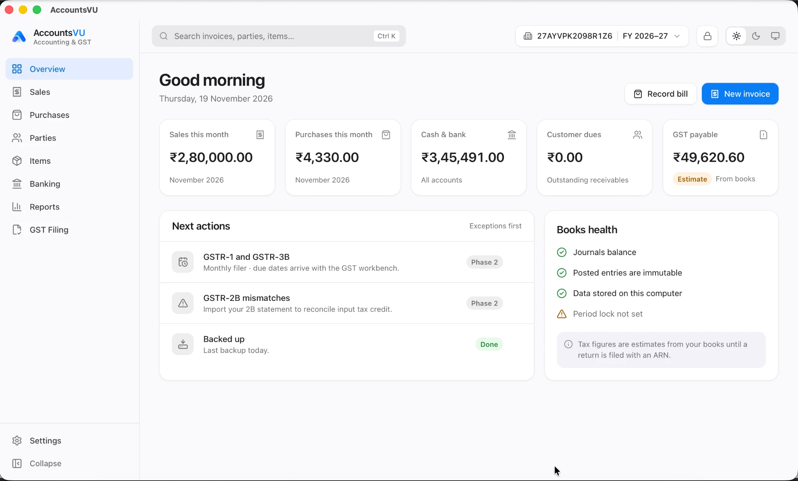
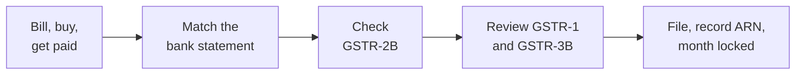
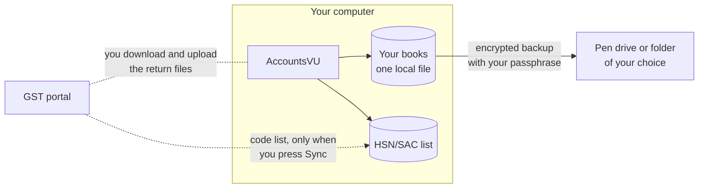

<div align="center">


# AccountsVU

**Accounts and GST for small Indian businesses. It runs on your computer and your books stay there.**

[](https://github.com/bkrajendra/accountsvu/releases/latest)
[](https://github.com/bkrajendra/accountsvu/releases)
[](https://github.com/bkrajendra/accountsvu/releases/latest)
[](LICENSE)

[**Download**](https://github.com/bkrajendra/accountsvu/releases/latest) · [What's next](#whats-next) · [Questions](#questions)



</div>

## Why AccountsVU

Most small shops, traders and freelancers keep their books in one of two ways. Some use spreadsheets and hand everything to their CA at the end of the month. Others pay every year for cloud software that holds their data on someone else's server. AccountsVU is a third way.

- **You don't need an account or the internet.** Install it and start billing. AccountsVU never uploads your books anywhere.
- **It's free and open source.** You don't pay a subscription or a per-user fee, and no feature is held back for a paid plan. Anyone can read the code and see what it does with your data.
- **GST is part of the app, not an add-on.** Every invoice and bill already carries what your returns need. At month end, GSTR-1 and GSTR-3B are drafted for you.
- **Posted entries can't be changed.** Once an invoice is issued or a bill is recorded, nobody can quietly edit or delete it. You correct a mistake with a credit note, a debit note or a reversal, so your books always show what really happened.
- **It speaks plain English.** You won't find "voucher types" or cryptic codes. Screens say "Record payment" and "Bill from supplier", and every warning tells you what to do next.

## What it does

| | |
|---|---|
| **Sales** | Tax invoices, bills of supply and credit notes, numbered for you. The tax is worked out as you type, and each invoice prints as a clean PDF with your logo. |
| **Purchases** | Supplier bills, expenses and debit notes, with the supplier's PDF attached. You decide which input tax credit to claim on each line; the app never assumes. |
| **Money in and out** | Receipts and payments matched against open invoices. Cash book and bank book. |
| **Bank reconciliation** | Import your bank statement (CSV or Excel). AccountsVU suggests the matches, and sure ones are matched with one click. |
| **Reports** | Profit and loss, balance sheet, trial balance, ledgers, party statements, and lists of who owes you and whom you owe (with ageing). Click any figure to see the entries behind it. |
| **GST returns** | GSTR-1 and GSTR-3B drafted from your books, with a list of problems to fix first. The portal file and an Excel workpaper are ready to save. |
| **GSTR-2B check** | Load the GSTR-2B file from the portal to compare your suppliers' filings with your bills, and see which credit is safe to claim. |
| **Month close** | Record the ARN once you've filed, and that month is locked. You also get a compliance pack to keep for an audit. |
| **HSN/SAC finder** | Search all 22,000+ HSN and SAC codes by number or by a word like "ghee". AccountsVU downloads the list from the GST portal and keeps a copy on your computer. |
| **Rate checks** | It warns you when a GST rate doesn't match the code or the invoice date, for example after the September 2025 rate changes. |
| **Safety** | Encrypted backups that are checked as soon as they're saved, an optional PIN lock, and a log of who changed what. |
| **Getting started** | Type your GSTIN and the setup fills in your PAN, state and business type. Bring in customers and items from Excel. |

## How a month looks



You can stop at any step and come back later. Nothing is final until you issue, record or file it.

## Where your data lives



AccountsVU only goes online when you ask for something from the internet: an app update, or a fresh copy of the HSN/SAC list. Your books never leave your computer unless you make a backup and put it somewhere.

## How it compares

| | Spreadsheet | Cloud accounting | **AccountsVU** |
|---|:---:|:---:|:---:|
| Yearly fee | Free | Every year, per user | **Free** |
| Works without internet | ✅ | ❌ | ✅ |
| Data stays on your computer | ✅ | ❌ | ✅ |
| GST returns drafted for you | ❌ | ✅ | ✅ |
| Entries can't be silently changed | ❌ | Varies | ✅ |
| You can read the code | — | ❌ | ✅ |

## Install

1. Open the [latest release](https://github.com/bkrajendra/accountsvu/releases/latest).
2. Download the file for your computer:
   - **Windows:** the `.msi` or `.exe` file.
   - **Mac:** the `.dmg` file.
   - **Linux:** the `.AppImage`, `.deb` or `.rpm` file.
3. Open it and follow the setup. Have your GSTIN ready; it fills in most of the details for you.

> **On a Mac:** the app isn't notarised by Apple yet. If it won't open the first time, go to **System Settings › Privacy & Security** and click **Open Anyway**.

AccountsVU checks for updates itself and asks before installing one.

## What's next

- **Now:** customer advances, refunds, and a review before filing.
- **Then:** filing returns directly from the app through a GST service provider, in addition to filing on the portal yourself.
- **Later:** recurring invoices, payment reminders on WhatsApp or email, simple stock, e-invoice and e-way bill, and backups to a cloud folder.

The full plan is in [docs/implementation-plan.md](docs/implementation-plan.md).

## Questions

**Is it really free?**
Yes. The whole app is free and the code is public. You won't find a trial period or a paid "pro" version.

**Can my CA use it with me?**
Yes. Send them a backup file and the passphrase, or give them the Excel workpapers and the compliance pack for each month.

**What if my computer dies?**
Make backups. A backup is one encrypted file that you can restore on any computer with AccountsVU installed. Keep it somewhere other than the computer itself, such as a pen drive.

**Does it file my GST return?**
It prepares the return and checks it. For now you upload the file on the GST portal yourself, then type the ARN back into AccountsVU. Filing from inside the app comes later.

**Is this a replacement for a CA?**
No. It keeps your books tidy and your returns ready, so your CA can spend their time on advice instead of data entry.

## Open source

AccountsVU is built in the open. You can read every line, report a problem, suggest an idea or send a fix on [GitHub Issues](https://github.com/bkrajendra/accountsvu/issues).

It is licensed under the [GNU Affero General Public License v3.0](LICENSE). In short, you can use it for your business free of charge, and study, change and share it. If you share a changed version, or run one for other people over a network, you must also share your changes under the same license.

For developers, the full product spec is in [docs/accountsvu-spec.md](docs/accountsvu-spec.md). To run it from source, you need Rust, Node 20+ and pnpm:

```bash
pnpm install
```

```bash
pnpm tauri dev
```

The app is built with Tauri, Rust, React and SQLite.
